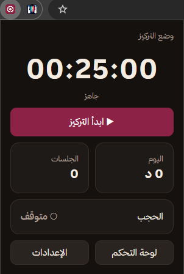
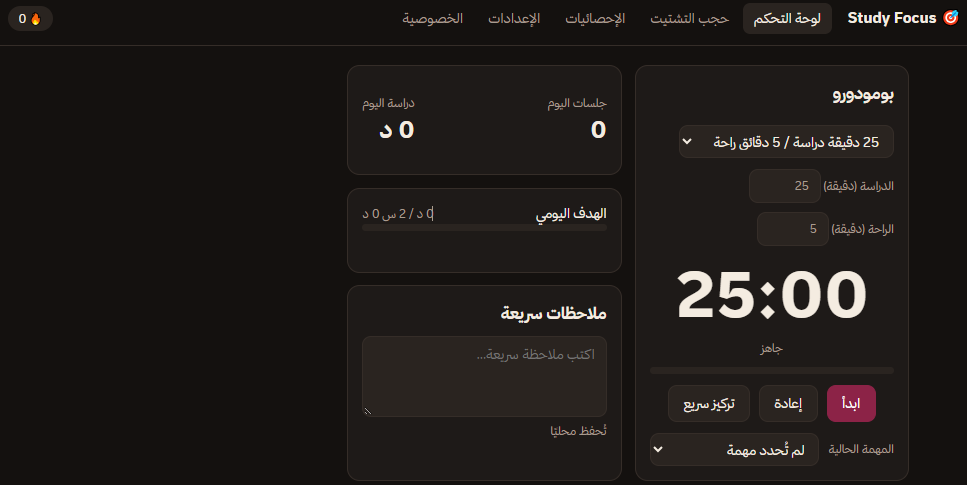
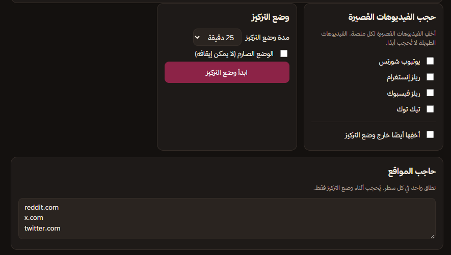

# Study Focus

### ركّز على أهدافك، واترك المشتّتات خارج جلسة الدراسة.

إضافة متصفح تساعدك على تنظيم وقت الدراسة باستخدام **Pomodoro**، وتقليل التشتّت عبر إعدادات حجب الفيديوهات القصيرة والمواقع التي تستهلك وقتك.

**Developed by [Omar Benbouzid](https://github.com/omarbenbouzid39)**  
**A project by OBZ Studio**

---

## لقطات من المشروع

### نافذة الإضافة السريعة

تمنحك وصولًا سريعًا إلى المؤقّت، ووضع التركيز، وإحصائيات اليوم، وإعدادات الإضافة.

### لوحة التحكم

واجهة تجمع مؤقّت Pomodoro، ومؤشرات الدراسة اليومية، والهدف اليومي، والملاحظات السريعة.

### وضع التركيز وحجب الفيديوهات القصيرة

إعدادات لتخصيص مدة التركيز وتحديد المنصات التي تريد إخفاء الفيديوهات القصيرة فيها، إلى جانب حجب مواقع تختارها أثناء التركيز.

---

## المميزات

- **مؤقّت Pomodoro:** تنظيم جلسات الدراسة والاستراحة، مع إمكانية تخصيص المدد.
- **وضع التركيز:** بدء جلسة مخصصة لتقليل مصادر التشتيت.
- **إعدادات حجب الفيديوهات القصيرة:** خيارات لمنصات YouTube Shorts وInstagram Reels وFacebook Reels وTikTok.
- **حاجب مواقع مخصص:** أضف المواقع التي تريد حجبها أثناء وضع التركيز، مثل `reddit.com` و`x.com`.
- **إحصائيات الدراسة:** متابعة وقت الدراسة وعدد الجلسات اليومية.
- **المهام:** اختيار المهمة الحالية وربطها بجلسة الدراسة.
- **ملاحظات سريعة:** تدوين الأفكار والملاحظات أثناء الدراسة.
- **واجهة عربية:** تصميم داكن واتجاه مناسب للغة العربية.
- **إعدادات قابلة للتخصيص:** لتكييف تجربة التركيز مع أسلوبك.

> **ملاحظة:** تعتمد فعالية حجب المحتوى على صلاحيات المتصفح وطريقة تنفيذ الإضافة والمنصات المستهدفة. قد تتغير واجهات المواقع، لذلك اختبر الحجب على كل منصة بعد تثبيت الإضافة. لا تعتبر لقطات الشاشة وحدها دليلًا على أن جميع الميزات تعمل في كل الحالات.

---

## التثبيت محليًا

يمكنك تجربة الإضافة في متصفح Chrome أو متصفح Chromium متوافق:

1. نزّل ملفات المشروع أو استنسخ المستودع.
2. فك ضغط الملفات إذا كانت في أرشيف ZIP.
3. افتح `chrome://extensions` في المتصفح.
4. فعّل **Developer mode** من أعلى الصفحة.
5. اضغط **Load unpacked**.
6. اختر المجلد الذي يحتوي على ملف `manifest.json`.

بعد التثبيت، ثبّت أيقونة Study Focus في شريط المتصفح لتسهيل الوصول إليها.

### التحديث بعد تعديل الملفات

بعد تعديل الكود، ارجع إلى صفحة `chrome://extensions` واضغط زر إعادة التحميل الخاص بالإضافة، ثم حدّث صفحات المواقع التي تختبر عليها الحجب.

---

## طريقة الاستخدام

1. افتح Study Focus من شريط المتصفح.
2. اختر مدة جلسة Pomodoro المناسبة لك.
3. فعّل المنصات التي تريد تقليل محتواها القصير.
4. أضف المواقع المشتّتة إلى حاجب المواقع عند الحاجة.
5. ابدأ وضع التركيز، ثم تابع وقتك ومهامك من لوحة التحكم.

---

## التقنية

تم إعداد المشروع بوصفه إضافة متصفح. وبحسب بنية النسخة الحالية، قد تشمل التقنيات المستخدمة:

- HTML
- CSS
- JavaScript
- Chrome Extensions API
- Manifest V3، إذا كان ملف `manifest.json` في المشروع يستخدم هذا الإصدار.

راجع ملفات المشروع الفعلية لمعرفة التقنيات والصلاحيات الدقيقة قبل النشر.

---

## الخصوصية

صُممت Study Focus لتكون أداة إنتاجية شخصية. قبل توزيع الإضافة، راجع الكود وتأكد من:

- توضيح البيانات التي تُخزَّن محليًا أو تُرسل إلى خدمات خارجية، إن وُجدت.
- طلب أقل قدر ممكن من صلاحيات المتصفح.
- مطابقة سياسة الخصوصية لوظائف الإضافة الفعلية.
- عدم تقديم وعود حول الخصوصية أو التخزين المحلي إلا بعد التحقق من التنفيذ.

---

## خارطة طريق مقترحة

- تحسين دقة حجب Shorts وReels عند تغيّر واجهات المنصات.
- إضافة تقارير أسبوعية أكثر تفصيلًا.
- تطوير تجربة المهام والأهداف الدراسية.
- تحسين إمكانية الوصول ودعم اللغتين العربية والإنجليزية.
- تجهيز حزمة إصدار موثّقة للنشر والتوزيع.

هذه أفكار تطوير مستقبلية وليست بالضرورة ميزات منفّذة في النسخة الحالية.

---

## المطوّر والشركة

**المطوّر:** Omar Benbouzid — عمر بن بوزيد  
**الشركة/الاستوديو:** OBZ Studio  
**GitHub:** [@omarbenbouzid39](https://github.com/omarbenbouzid39)

Study Focus مشروع يهدف إلى مساعدة الطلاب على بناء عادات دراسة أكثر انتظامًا وتقليل الوقت الذي تستهلكه المشتّتات الرقمية.

---

## الترخيص

لم يُحدَّد ترخيص لهذا المشروع في هذا الملف. قبل نشر الكود للعامة، أضف ملف `LICENSE` يوضّح كيفية استخدام المشروع وإعادة توزيعه. لا تفترض أن المشروع مفتوح المصدر أو مسموح بإعادة استخدامه دون ترخيص واضح.

---

**Study Focus — Developed by OBZ Studio**

